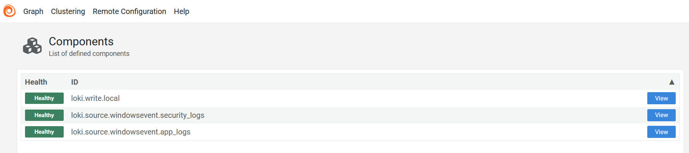
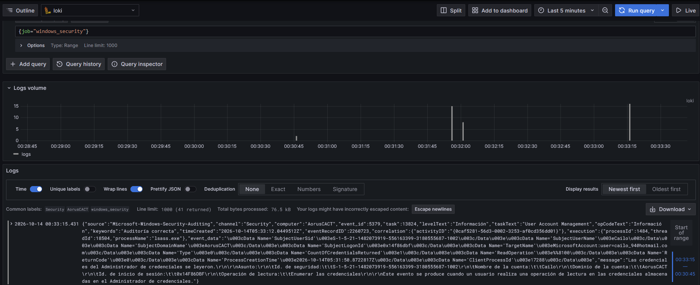

# Windows Security & Application Log Pipeline to Grafana Loki via Grafana Alloy

Este repositorio documenta la implementación de un pipeline ligero y eficiente para la recolección, transporte y centralización de registros de eventos de Windows (**Security** y **Application**) hacia un servidor centralizado con **Grafana Loki**, utilizando **Grafana Alloy** como agente colector en el host.

---

## 🏗️ Arquitectura de la Solución

```text
+-------------------------------------------------------------+               +----------------------------------+
|                   Windows Host (Alloy Agent)                |               |        Ubuntu VM (Server)        |
|  +------------------+     +------------------------------+  |  (HTTP Push)  |  +----------------------------+  |
|  | Windows Security | --> |                              |  | ------------> | | Grafana Loki (@ port 3100) |  |
|  +------------------+     | Grafana Alloy                |  |               | +----------------------------+  |
|  +------------------+     | (Puerto Web HTTP: 12346)     |  |               |               |                  |
|  | Windows App      | --> |                              |  |               |               v                  |
|  +------------------+     +------------------------------+  |               |  +----------------------------+  |
|                           | loki.write.local             |  |               | | Grafana UI (@ port 3000)   |  |
|                           +------------------------------+  |               | +----------------------------+  |
+-------------------------------------------------------------+               +----------------------------------+
```

---

## 📋 Componentes Clave

1. **Agente Colector (`Grafana Alloy`)**: Desplegado en el host de Windows para leer de forma nativa los canales de eventos del sistema operativo (`Security` y `Application`).
2. **Transporte (`Loki Push API`)**: Envío de registros en tiempo real mediante solicitudes HTTP POST optimizadas hacia el colector Loki remoto (`http://<IP_SERVIDOR_LOKI>:3100/loki/api/v1/push`).
3. **Visualización y Triage (`Grafana Explore`)**: Análisis de logs mediante LogQL para filtrado por etiquetas (`job="windows_security"`) e identificación de eventos de auditoría (ej. `event_id 5379`).

---

## ⚙️ Configuración del Agente (`config.alloy`)

El archivo de configuración define los componentes encargados de extraer los eventos de Windows y reenviarlos al backend de Loki:

```alloy
logging {
    level = "info"
    format = "logfmt"
}

loki.source.windowsevent "security_logs" {
    eventlog_name = "Security"
    forward_to    = [loki.write.local.receiver]
    poll_interval = "5s"
    labels        = {
        job = "windows_security",
    }
}

loki.source.windowsevent "app_logs" {
    eventlog_name = "Application"
    forward_to    = [loki.write.local.receiver]
    poll_interval = "5s"
    labels        = {
        job = "windows_application",
    }
}

loki.write "local" {
    endpoint {
        url = "http://<IP_SERVIDOR_LOKI>:3100/loki/api/v1/push"
    }
}
```

---

## 🛠️ Consideraciones y Resolución de Problemas

### 1. Conflicto de Puertos HTTP Internos
* **Problema:** Por defecto, Grafana Alloy intenta levantar su servidor web interno en el puerto `12345`. Si este puerto ya está ocupado por otro proceso o servicio en el host, la interfaz de administración web crashea y no muestra los componentes.
* **Solución:** Se evita el conflicto reasignando el puerto de escucha web a través de un parámetro en la ejecución (`12346`).

### 2. Automatización Local (`iniciar_alloy.bat`)
Para facilitar la ejecución interactiva del agente con permisos de administrador y el puerto personalizado configurado, se implementó un script batch (`iniciar_alloy.bat`) ubicado en la ruta de instalación (`C:\Program Files\GrafanaLabs\Alloy`):

```cmd
@echo off
cd /d "C:\Program Files\GrafanaLabs\Alloy"
alloy-windows-amd64.exe run --server.http.listen-addr="127.0.0.1:12346" config.alloy
pause
```

---

## 🔍 Evidencias del Proyecto

1. **Estado de salud de Alloy (`http://127.0.0.1:12346`):**
   Muestra los componentes `loki.write.local`, `security_logs` y `app_logs` en estado **Healthy**.

   

2. **Flujo de Logs en Grafana (Grafana Explore):**
   Muestra la recepción continua de eventos (ej. `event_id 5379`) utilizando la consulta LogQL `{job="windows_security"}`.

   